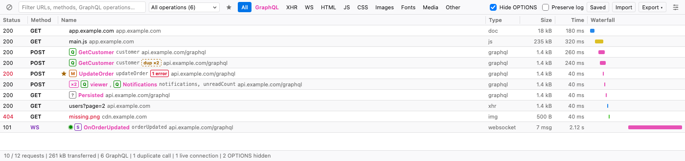
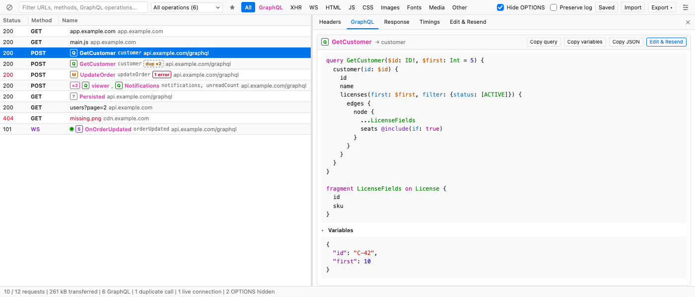
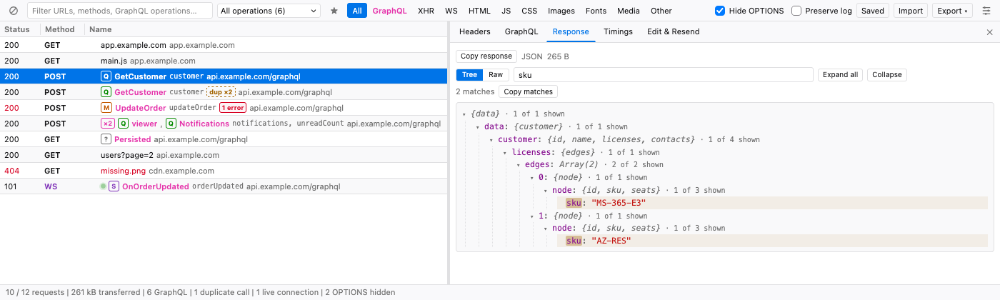
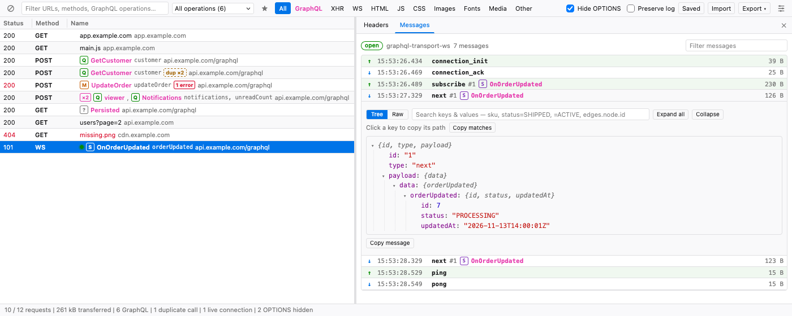
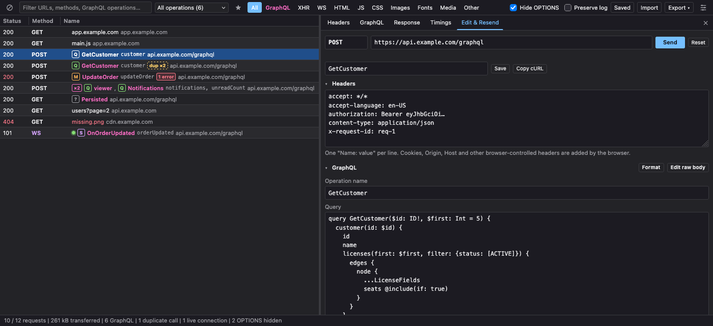

<div align="center">


# Network+

**A GraphQL-aware network inspector for Firefox DevTools.**

See which GraphQL operation each request runs, read formatted queries, search responses,
watch subscriptions live, and edit & resend — without leaving DevTools.

[](https://github.com/maherlandolsi/network-graphy/actions/workflows/ci.yml)
[](LICENSE)


</div>



## Why

In the built-in Network panel every GraphQL call looks the same: `POST /graphql`. Network+ shows the operation behind each request, formats the query, and adds the tools you reach for when debugging a GraphQL app.

## Features

### GraphQL
- **Operations in the request list** — type badge (**Q**uery / **M**utation / **S**ubscription), operation name, root fields and URL. Anonymous operations show their root fields.
- **Filter by operation** — a dropdown of every operation seen, with call counts.
- **Formatted queries** — pretty-printed, syntax-highlighted query, variables and extensions.
- **Errors at a glance** — responses with an `errors` array are flagged in the list and summarized above the response, even with HTTP 200.
- **Duplicate calls** — a `dup ×N` badge when the same operation and variables are sent again within 5 seconds.
- **Live subscriptions** — WebSocket and EventSource connections with a *Messages* tab; `graphql-transport-ws` and `subscriptions-transport-ws` messages are labeled by operation.
- Batched requests, GET queries, persisted queries (APQ) and multipart uploads are recognized.



### Inspecting responses
- **JSON tree** with a Tree/Raw toggle; click any key to copy its path (`data.customer.licenses.edges[0]`).
- **Tree search** by key and/or value that shows a filtered tree with highlights and original array indexes:

  | Query | Matches |
  |---|---|
  | `sku` | keys or values containing "sku" |
  | `status=SHIPPED` | key and value on the same field |
  | `=ACTIVE` | values only |
  | `email=` | keys only |
  | `edges.node.id` | full path |





### Working with requests
- **Hide OPTIONS** preflight requests (on by default).
- **Edit & Resend** — edit method, URL, headers and body (for GraphQL: operation name, query and variables as separate fields). The request is replayed from the page, with its cookies and CORS rules.
- **Saved requests** — keep requests to edit and replay later; export them as a Postman collection.
- **Copy as** URL, cURL, `fetch()`, Postman collection or response, from *Copy ▾* or the right-click menu.
- **Export / import HAR** (all or filtered, with response bodies and socket messages) to attach to a ticket. Imports HAR files from Network+, Firefox or Chrome.
- **Bookmarks** for requests and operations, and **pinned headers** that stay at the top of every header list.
- **Columns** — sortable, resizable, configurable (Status, Method, Name, Domain, Type, Size, Time, Waterfall).
- Type and text filters (`-term` excludes), preserve log, timings, keyboard navigation, light and dark themes.



## Install

### From source (temporary)

1. Clone this repository.
2. Open `about:debugging#/runtime/this-firefox` in Firefox 128 or newer.
3. Click **Load Temporary Add-on…** and select `manifest.json`.
4. Open DevTools (F12) → **Network+**, then reload the page.

Temporary add-ons are removed when Firefox restarts.

### Permanent install

Firefox only installs signed add-ons permanently. To sign your own copy without publishing it:

1. Run `npm run package` → `dist/network-plus-<version>.zip`. Tagged releases also attach this zip on the [Releases](https://github.com/maherlandolsi/network-graphy/releases) page.
2. On [addons.mozilla.org/developers](https://addons.mozilla.org/developers/), choose **Submit a New Add-on → On your own** and upload the zip.
3. Open the signed `.xpi` in Firefox.

## Privacy

Network+ sends nothing anywhere and collects no telemetry. Captured traffic stays in the DevTools window.

It asks for access to all sites only because Firefox's DevTools API doesn't expose WebSocket messages: a small script observes them in each page and forwards them **only while Network+ is open on that tab**. If you decline that permission, everything except live WebSocket/SSE capture still works. See [SECURITY.md](SECURITY.md).

## Development

No dependencies and no build step. You need Node.js 20+.

```sh
npm test         # unit tests: GraphQL parsing & formatting, exporters, HAR, tree search
npm start        # dev server → http://localhost:8000/test/live.html
npm run check    # syntax-check every script and the manifest
npm run package  # build dist/network-plus-<version>.zip
```

- **`test/live.html`** sends real GraphQL requests (with CORS preflights), duplicate calls, a GraphQL subscription over WebSocket and an SSE stream.
- **`test/demo.html`** runs the panel with fake data, no extension needed. URL parameters: `dark=1`, `select=<row id>`, `tab=headers|payload|response|timings|resend|messages`, `op=<operation>`, `search=<tree query>`, `seedSaved=1`, `bookmark=<key>`, `pin=<header,…>`, `click=<selector|…>`, `reset=1`.

### Project layout

```
manifest.json          MV3 manifest (Firefox 128+)
background.js          Relays socket events from content scripts to DevTools
content/hook.js        Page-world script observing WebSocket / EventSource
content/relay.js       Forwards events only while Network+ inspects the tab
devtools/devtools.js   Captures requests and bodies, replays Edit & Resend
panel/                 Panel UI and JSON tree
lib/graphql.js         GraphQL detection, parsing, formatting, highlighting
lib/exporters.js       cURL, fetch, Postman v2.1, HAR import/export
scripts/package.sh     Builds the zip for signing
test/                  Unit tests, demo page, live test page, dev server
```

## Contributing

Issues and pull requests are welcome. See [CONTRIBUTING.md](CONTRIBUTING.md).

## License

[MIT](LICENSE) © Maher Landolsi
